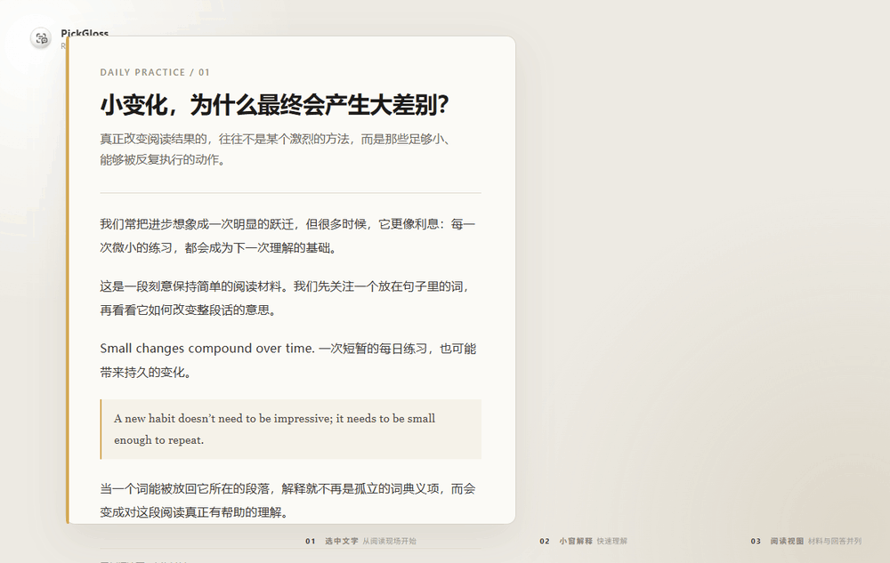
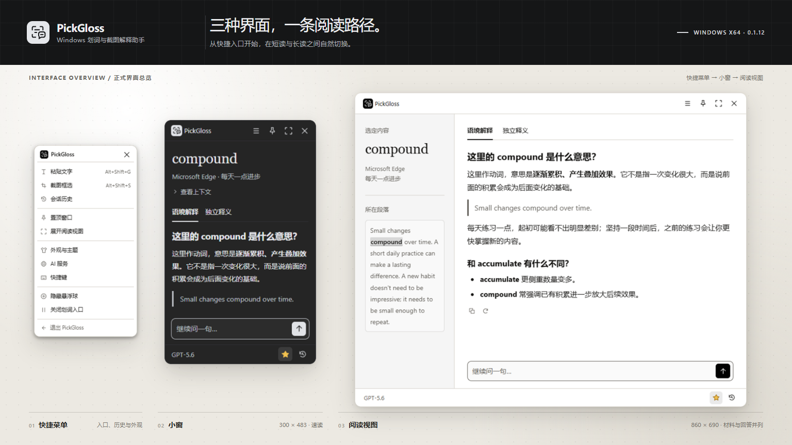

<a id="readme-top"></a>

<div align="center">
  <a href="https://github.com/qwayo/PickGloss">
    
  </a>

  <h1>PickGloss</h1>

  <p>
    在阅读现场选中文字或框选截图，立即获得解释，继续追问，并在本地留下可回访的阅读笔记。
    <br />
    Windows x64 · Electron · 本地优先 · 0.1.12
  </p>

  <p>
    
    
    
    
    
  </p>

  <p>
    <a href="#overview"><strong>了解 PickGloss</strong></a>
    &middot;
    <a href="#getting-started">快速开始</a>
    &middot;
    <a href="#usage">使用方式</a>
    &middot;
    <a href="#development">开发</a>
    &middot;
    <a href="#roadmap">路线图</a>
    &middot;
    <a href="#license">许可证</a>
  </p>
</div>

<div align="center">
  
  <br />
  <sub>选中文字 → 就地解释 → 展开阅读视图；演示使用虚构阅读材料。</sub>
</div>

> [!WARNING]
> 当前可执行文件尚未进行正式代码签名。Windows 可能在启动时显示“未知发布者”或 SmartScreen 提示；请先核对下载来源和 Release 中公布的 SHA-256。

<a id="overview"></a>

## 产品概览

PickGloss 是一款 Windows 划词与截图解释助手。它把“查一下这个词”变成一条连续的阅读动作：

1. 在浏览器、PDF 阅读器或办公软件中选中文字，点击选区附近的划词入口。
2. 使用可信段落进行**语境解释**，或者在没有上下文时进行**独立释义**。
3. 遇到无法取词的图表、代码截图或扫描页面，直接框选屏幕区域并补充说明。
4. 在紧凑小窗中快速读完，或展开为左侧材料、右侧回答的阅读视图继续追问。
5. 让材料、问答和草稿留在本机会话历史中，收藏后继续补充。

<p align="right">(<a href="#readme-top">回到顶部</a>)</p>

## 核心能力

| 能力 | 说明 |
| --- | --- |
| 划词解释 | 读取 Windows 辅助功能提供的选区与可信段落；不模拟复制，不擅自改动剪贴板。 |
| 两种文字模式 | 语境解释只使用当前材料与段落；独立释义只依据选定内容，两种模式的问答和草稿彼此隔离。 |
| 截图理解 | 通过 `Alt+Shift+S` 框选鼠标所在显示器，先预览，再直接解释或添加截图说明。 |
| 阅读工作区 | 小窗为 300 × 483、阅读视图为 860 × 690（逻辑像素）；在阅读视图中材料与回答并列。 |
| 本地会话 | 会话、材料、截图、问答和草稿保存在本机，支持搜索、改名、日期分组、收藏和回收站删除。 |
| 回答操作 | 流式显示 Markdown 回答，支持停止生成、手动重试和复制原始 Markdown。 |
| 外观与快捷键 | 深色、浅色、跟随系统，实色或磨砂；保存自定义主题预设，并录制 10 项全局快捷键。 |
| 兼容 AI 服务 | 使用 OpenAI 兼容的 `/chat/completions` 接口；文字与识图可共用配置，也可分别配置。 |

<p align="right">(<a href="#readme-top">回到顶部</a>)</p>

## 界面预览

<div align="center">
  
  <br />
  <sub>一张图看三条阅读路径：快捷菜单负责入口与设置，小窗完成快速解释，阅读视图承载材料与回答的持续阅读。</sub>
</div>

> 画面由当前 `src/renderer/` 的正式界面配合虚构阅读材料生成；快捷菜单、小窗与阅读视图均完整呈现，具体显示效果可能随 Windows 缩放和主题能力略有差异。

<p align="right">(<a href="#readme-top">回到顶部</a>)</p>

<a id="getting-started"></a>

## 快速开始

### 使用便携版

便携版本由 `npm run package` 生成到：

```text
dist/<构建时间戳>/PickGloss-win32-x64/
```

解压后运行 `PickGloss-win32-x64/PickGloss.exe`。请保留整个目录，尤其是 `resources/`、`locales/` 和 `resources/native/ContextProbe.exe`；只拿走可执行文件无法运行。

每个包旁边会生成 `candidate-manifest.json`、`README.txt` 和 `release-checksum.json`。拿到 ZIP 时，先通过独立渠道核对 SHA-256，再执行：

```powershell
node scripts/verify-package.cjs <解压目录> --expected-zip-sha256=<ZIP 的 SHA-256>
```

### 从源码运行

### 环境要求

- Windows x64
- Node.js 与 npm
- Windows 自带的 .NET Framework C# 编译器（用于构建原生段落助手，不需要安装 .NET SDK）

### 安装

```powershell
git clone https://github.com/qwayo/PickGloss.git
cd PickGloss
npm ci
npm run build:native
npm start
```

首次安装 Electron 时需要下载运行时。`npm run build:native` 会生成 `build/native/ContextProbe.exe`，应用通过 Windows UI Automation 读取真实选区与段落。

<p align="right">(<a href="#readme-top">回到顶部</a>)</p>

<a id="usage"></a>

## 使用方式

### 1. 配置 AI 服务

打开窗口底部的「AI 服务」或「配置 AI 服务」，填写：

- 服务地址：例如 `https://api.example.com/v1` 或本机 `http://127.0.0.1:1234/v1`
- 模型名称：服务支持的文字模型名称
- API Key：按服务要求填写；已经保存的密钥留空时不会被清空

服务需要兼容 OpenAI 的 `/chat/completions` 接口。远程地址必须使用 HTTPS；`localhost`、`127.0.0.1` 和 `::1` 可以使用 HTTP。

识图模型名称留空时，截图解释、截图追问和识图连接测试会完整沿用文字模型的地址、模型与密钥。填写独立识图模型后，识图请求只使用识图配置；配置不完整或请求失败时会明确提示，不会悄悄切换到另一个服务。

连接测试会发送一条短文字请求；识图测试会发送内置小图片，并可能产生服务费用。解释请求超时为 60 秒，连接测试超时为 15 秒。

### 2. 解释选中文字

1. 在支持 Windows 辅助功能取词的软件里拖选文字。
2. 松开鼠标后，点击选区下方或上方的划词入口。
3. 有可信段落时使用「语境解释」；无法取得段落时，可以切换到「独立释义」，或手动补充所在段落。
4. 在输入框继续追问，按 `Enter` 发送，按 `Shift+Enter` 换行。

划词入口固定在鼠标松开时的屏幕位置，滚动不会让它跟随或消失；点击入口外部、按 `Esc` 或重新划词会取消或替换旧入口。点击普通划词不会自动发送请求，只有点击入口后才接纳材料。

### 3. 解释截图

按 `Alt+Shift+S`，在鼠标所在显示器框选区域，松手后先检查预览。可以直接解释，也可以补充“请关注图表中的哪条曲线”之类的截图说明。按 `Esc` 取消。截图只从框选区域裁剪成 PNG，上限为 15 MiB。

### 4. 管理会话与窗口

- 历史图标会按日期分组列出会话，搜索覆盖标题、原文、上下文、截图说明和所有模式的问答。
- 星形图标收藏整个会话；取消收藏不会删除历史。
- 删除会话会把会话及截图移到 Windows 回收站。
- 悬浮球整球可拖，左键默认打开或关闭最新会话，也可改为截图框选；右键打开菜单。
- 固定窗口在其他软件获得焦点时仍保持可见；新的划词到来时，固定窗口留在原位。

### 默认快捷键

| 功能 | 默认快捷键 |
| --- | --- |
| 粘贴文字 | `Alt+Shift+G` |
| 截图框选 | `Alt+Shift+S` |
| 置顶或取消置顶 | `Alt+Shift+P` |
| 展开或收窄 | `Alt+Shift+W` |

「快捷键设置」还可以为历史、外观、悬浮球、划词入口、停止回答和关闭面板等 10 项功能录制组合键。组合键被其他程序占用或写入失败时，原设置与编辑草稿会保留。

<p align="right">(<a href="#readme-top">回到顶部</a>)</p>

## 数据与隐私

- 设置与会话保存在 `%LOCALAPPDATA%\PickGloss\data`。
- API Key 使用 Electron `safeStorage` 交给 Windows 加密保存，界面不会以明文返回已保存密钥。
- 会话正文与截图是本机普通文件，不是加密知识库；备份或共享目录前请自行评估其中的材料。
- 只有点击解释、追问或测试连接时才会调用配置的服务；没有后台批量上传，也没有云端历史同步。
- 语境解释发送选定文字、可信段落和该模式对话；独立释义只发送选定文字和独立模式对话；截图解释只发送裁剪图片、截图说明和截图对话。
- 普通划词不模拟复制快捷键，不读取或改写剪贴板；只有点击「复制 Markdown」时才写入剪贴板。
- 会话中的 HTML 按文字显示，远程图片不会自动加载，链接需要主动点击。

本地数据目录如下。密钥密文在 `settings.json`；会话记录与截图位于各自的会话目录，三者不是同一个文件。

```text
%LOCALAPPDATA%\PickGloss\data\
├── settings.json                  # 服务设置与加密后的密钥密文
└── sessions\
    └── <会话 ID>\
        ├── session.json           # 会话正文、问答与截图说明
        └── crop.png               # 截图会话的裁剪图片
```

> PickGloss 不会替你判断所选 AI 服务如何保存请求。发送敏感材料前，请阅读对应服务的隐私政策。

材料上限：

| 项目 | 上限 |
| --- | --- |
| 选定文字 | 12,000 字符 |
| 上下文段落 | 6,000 字符 |
| 追问或截图说明 | 4,000 字符 |
| 单次文字材料与历史总预算 | 40,000 字符 |
| 截图 PNG | 15 MiB |

超过限制时会明确提示，不会静默截断；超限划词只保留提示入口，不创建无效会话或发送请求。

<p align="right">(<a href="#readme-top">回到顶部</a>)</p>

## 架构

```text
PickGloss/
├── src/
│   ├── main.cjs                 # Electron 主进程、IPC、窗口与请求生命周期
│   ├── preload.cjs              # renderer 与主进程之间的最小桥
│   ├── core/
│   │   ├── provider.cjs         # OpenAI 兼容协议与模式材料隔离
│   │   ├── store.cjs            # 设置、会话、草稿与回收站
│   │   ├── history.cjs          # 历史索引、搜索与展示
│   │   ├── validation.cjs       # 字符与图片大小限制
│   │   ├── appearance.cjs       # 主题与预设校验
│   │   └── shortcuts.cjs        # 快捷键规范化与注册边界
│   ├── windows/
│   │   ├── desktop.cjs          # 托盘、悬浮球、菜单、截图与全局入口
│   │   ├── geometry.cjs         # 工作区、DPI 与窗口布局计算
│   │   ├── selection-worker.cjs # 选区材料移交
│   │   └── ContextProbe.cs      # UI Automation 原生段落助手
│   └── renderer/                # 小窗、阅读视图、设置、历史与 Markdown
├── scripts/                     # 原生构建、打包、核验与交互检查
├── tests/                       # 核心、窗口、渲染器与包完整性测试
├── docs/                        # 规格、设计与研究文档
├── prototypes/                  # 本机设计样机与截图证据（不进入公开仓库）
└── DESIGN.md / GLOSSARY.md      # 设计规范与领域词汇
```

主进程负责窗口与材料生命周期，渲染器只通过白名单 IPC 访问桌面能力。文字与截图使用不同材料构造器；会话写入不等待模型成功，因此未解释、失败与停止的会话也能保留。

<p align="right">(<a href="#readme-top">回到顶部</a>)</p>

<a id="development"></a>

## 开发

### 常用命令

```powershell
npm start              # 从源码启动正式应用
npm run build:native   # 构建 UI Automation 段落助手
npm test               # 核心、Windows、渲染器测试
npm run test:host      # Electron 宿主契约与本机安全能力
npm run test:interaction
npm run test:markdown
npm run smoke          # 隔离数据目录下的启动检查
npm run package        # 构建、打包、校验并生成 ZIP
npm run check:publication
```

额外的界面检查需要 Electron，并使用隐藏窗口、临时数据目录和虚构材料，不访问真实 AI 服务或正常会话：

```powershell
npx --no-install electron scripts/check-ui-refinements.cjs
npx --no-install electron scripts/check-ui-appearance.cjs
npx --no-install electron scripts/check-brand-entries.cjs
```

`npm test` 会打开隔离 Electron 窗口，不适合当作完全后台的纯 Node 检查。`npm run smoke` 使用独立临时数据目录；隔离模式不会启动系统划词监听、悬浮球或全局快捷键，也不会读写系统剪贴板。

### 发布检查

```powershell
npm ci
npm test
npm run check:publication
npm run package
```

`npm run package` 会使用白名单裁剪运行文件，并核对源码、原生助手和包内文件摘要。不要手工修改打包目录中的 `candidate-manifest.json`；如果包内容变化，应重新打包并生成新的清单和校验和。

### 目录约定

- 新增运行时代码放在 `src/`，新增测试放在 `tests/`。
- 不把本机路径、API Key、`settings.json`、会话数据、验收截图或 ZIP 放进公开提交。
- `docs/verification/`、`output/`、`dist/`、`prototypes/` 默认留在本机；需要公开证据时，先逐项脱敏并在 Issue 或文档中说明证据范围。
- 所有用户可见文本使用中文；领域概念使用 `GLOSSARY.md` 中的名称。

<p align="right">(<a href="#readme-top">回到顶部</a>)</p>

## 当前边界

当前验证版面向 Windows 11 x64、单屏环境，重点覆盖桌面划词、截图解释、本地会话与便携包。以下项目尚未作为本版本的公开承诺：

- macOS、Linux、Windows 10、ARM64 与多显示器兼容性
- 安装器、自动更新、开机自启、系统商店分发和正式代码签名（当前发行版未签名，Windows 可能显示未知发布者）
- 对所有浏览器、WPS、PDF 阅读器、办公软件或显示缩放组合的兼容性
- 跨资料检索问答、全文文件导入、长期原文记号、图片圈画与箭头标注
- 真实模型质量、费用与可用性的普遍保证

从源码构建、Electron 交互检查、Windows 宿主检查和便携包核验是不同的证据，不能互相替代。真实桌面划词、真实截图、真实 AI 服务和用户主路径需要在目标 Windows 环境中单独验收。

<p align="right">(<a href="#readme-top">回到顶部</a>)</p>

<a id="roadmap"></a>

## 路线图

- [x] Windows 划词入口与可信段落采集
- [x] 语境解释、独立释义与截图解释
- [x] 小窗、阅读视图、固定窗口与位置记忆
- [x] 会话历史、搜索、收藏、改名与回收站删除
- [x] Markdown 渲染、停止、重试与原始内容复制
- [x] 深色、浅色、跟随系统、磨砂与主题预设
- [x] 10 项全局快捷键录制
- [x] 便携包白名单、候选清单与校验和
- [x] 在 GitHub Releases 发布带校验和的便携包
- [ ] 补充目标 Windows 环境下的真实设备验收记录
- [ ] 评估安装器、自动更新与正式代码签名

路线图只说明维护方向，不代表尚未完成的项目已经通过验证。

<p align="right">(<a href="#readme-top">回到顶部</a>)</p>

## 贡献

欢迎通过 Issue 报告问题或提出功能建议。提交变更前请先阅读仓库中的 `AGENTS.md`，并遵守以下约定：

1. 先创建或确认对应的 GitHub Issue，再开始较大范围的实现。
2. 使用 `codex/` 前缀创建分支，保持提交范围清晰。
3. 提交前运行相关测试、`npm test` 和 `npm run check:publication`。
4. 不为通过测试而降低断言、伪造验收结果或把未执行的检查写成已通过。
5. 不提交凭据、本机用户数据、未脱敏截图或与变更无关的生成文件。

<p align="right">(<a href="#readme-top">回到顶部</a>)</p>

## 致谢

- [Best-README-Template](https://github.com/othneildrew/Best-README-Template)：本 README 的信息架构参考。
- [oil-ui](https://github.com/oil-oil/oil-ui)：界面设计与视觉方向参考。
- [beautify-github-readme](https://github.com/oil-oil/beautify-github-readme)：README 视觉设计与演示素材制作参考。
- [Electron](https://www.electronjs.org/)：跨平台桌面运行时。
- [markdown-it](https://github.com/markdown-it/markdown-it)：Markdown 渲染。
- [selection-hook](https://github.com/0xfullex/selection-hook)：系统选区事件支持。
- Windows UI Automation：原生选区与段落信息采集。

<p align="right">(<a href="#readme-top">回到顶部</a>)</p>

<a id="license"></a>

## 许可证

本项目采用 [MIT License](LICENSE)。

<p align="right">(<a href="#readme-top">回到顶部</a>)</p>
